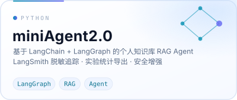
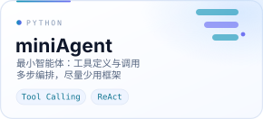
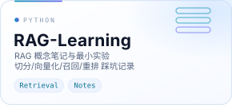

<picture>
  <source media="(prefers-color-scheme: dark)" srcset="./assets/hero-dark.svg">
  <source media="(prefers-color-scheme: light)" srcset="./assets/hero-light.svg">
  
</picture>

<h2 align="center">🧭 关于我</h2>

  🎯 现阶段目标：把 RAG 与 Agent 从「能跑起来」推进到「可验证、可复现、可交付」

<h2 align="center">🚀 项目</h2>

<table align="center" border="0" cellspacing="10" cellpadding="0">
  <tr>
    <td width="33%" valign="top">
      <a href="https://github.com/HXIAO6/miniAgent2.0">
        <picture>
          <source media="(prefers-color-scheme: dark)" srcset="./assets/card-miniagent2-dark.svg">
          <source media="(prefers-color-scheme: light)" srcset="./assets/card-miniagent2-light.svg">
          
        </picture>
      </a>
    </td>
    <td width="33%" valign="top">
      <a href="https://github.com/HXIAO6/miniAgent">
        <picture>
          <source media="(prefers-color-scheme: dark)" srcset="./assets/card-miniagent-dark.svg">
          <source media="(prefers-color-scheme: light)" srcset="./assets/card-miniagent-light.svg">
          
        </picture>
      </a>
    </td>
    <td width="33%" valign="top">
      <a href="https://github.com/HXIAO6/RAG-Learning">
        <picture>
          <source media="(prefers-color-scheme: dark)" srcset="./assets/card-raglearning-dark.svg">
          <source media="(prefers-color-scheme: light)" srcset="./assets/card-raglearning-light.svg">
          
        </picture>
      </a>
    </td>
  </tr>
</table>

<h2 align="center">🛠 技术栈</h2>

  
  
  
  
  
  
  

<h2 align="center">🐍 贡献图</h2>

  <picture>
    <source media="(prefers-color-scheme: dark)" srcset="https://raw.githubusercontent.com/HXIAO6/HXIAO6/output/snake-dark.svg">
    <source media="(prefers-color-scheme: light)" srcset="https://raw.githubusercontent.com/HXIAO6/HXIAO6/output/snake.svg">
    
  </picture>

  由 GitHub Actions 每天自动生成 · <a href="https://github.com/HXIAO6/HXIAO6/actions/workflows/snake.yml">workflow</a>

<h2 align="center">📫 联系</h2>

  
  

